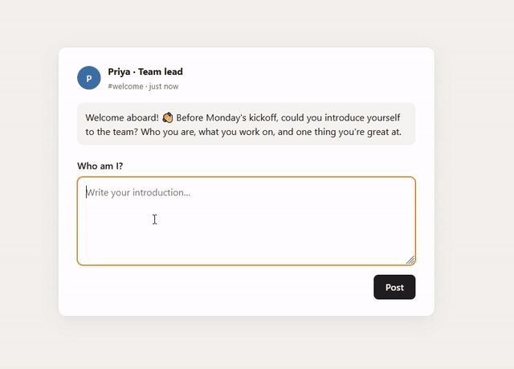

<p align="center"></p>
<h1 align="center">gopu.</h1>
<p align="center"><b>Your little buddy with a big memory.</b><br>Remembers what you saw. Writes what you mean.</p>
<p align="center">
<a href="https://github.com/TusharKanjariya/gopu/releases/latest"></a>


</p>

<p align="center"></p>

## Tap one key in any text box

| The box has… | Gopu… |
|---|---|
| nothing | drafts a reply from what's on screen |
| your draft | polishes it, in your style |
| an instruction ("make this shorter", "say no politely") | carries it out |
| a selection | rewrites just that part |

It works in mail, chat, browsers and documents, in the app you're already in.

## Ask your memory anything

Gopu reads on-screen text through Windows accessibility (never screenshots) into a local, searchable memory. Tap the
key outside a text box and ask: *"what did I do today?"*, *"what's unfinished?"*, or a saved ask like your daily work
report, in your own format. Every answer links to what it came from.

## Open, free and yours

- **Open source**, so you can check what an app that reads your screen does.
- **Bring any model**: Groq's free tier, OpenAI, Anthropic, OpenRouter, or Ollama on your own PC.
- **Nothing in the background**: no account, no analytics, no model calls you didn't ask for.

## Install

Windows 10 or 11 (64-bit). No admin rights needed.

1. Download **`Gopu_0.1.0_x64-setup.exe`** from the [latest release](https://github.com/TusharKanjariya/gopu/releases/latest).
2. Windows may say **"Windows protected your PC"**. Click **More info → Run anyway**. This preview isn't code-signed
   yet; to check the download is ours, compare `Get-FileHash .\Gopu_0.1.0_x64-setup.exe` with `SHA256SUMS.txt` on
   the release page (upper or lower case doesn't matter).
3. The welcome asks for a model key. A free [Groq key](https://console.groq.com/keys) takes a minute, or pick
   Ollama to keep everything on your PC.
4. Click into any text box and tap **Right Ctrl**.

Gopu starts with Windows and updates itself when you say so. Uninstalling keeps your memory unless you tick the box
to delete it.

## Privacy

| Stays on your PC | Leaves your PC |
|---|---|
| Everything memory captures, in one local file | A Gopu-key tap or a question: sent to **your** model, only when you ask |
| Your people pages, style rules and chats | The daily update check, which carries nothing about you |
| Your model key, in the Windows credential store | Nothing else. No account, no analytics |

Memory never reads passwords, sign-in or payment pages, banks, health sites, password managers or private windows.
Card numbers, keys and ID numbers are masked before anything is saved. Pause it, add apps to "Never capture", or
turn it off in **Settings → Privacy**.

## Use your memory in other AI apps

Turn on **Settings → Privacy → Let other AI apps read my memory**, then **Copy setup** for Claude Code, Claude Desktop,
Cursor or any MCP client. It's read-only and masked, and nothing is added to other apps for you.

## Build from source

```sh
cargo test -p gopu-core
cargo build -p gopu-desktop            # Gopu.exe and gopu-mcp.exe
cd apps/desktop && npx @tauri-apps/cli@2 build   # the installer
```

## Status

0.1.0 is a **preview**: Windows only, English interface, and settings or memory formats may change between 0.x
versions. See [known issues](https://github.com/TusharKanjariya/gopu/issues). macOS is next.

## Contributing

Issues and pull requests are welcome; see [CONTRIBUTING.md](CONTRIBUTING.md). Security problems go through
[SECURITY.md](SECURITY.md).

## Licence

Code: [Apache-2.0](LICENSE). The Gopu name, mascot and logo are reserved: [TRADEMARKS.md](TRADEMARKS.md).
